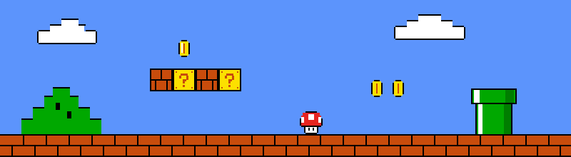
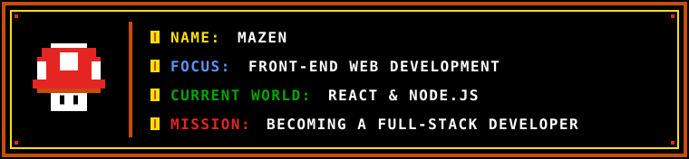
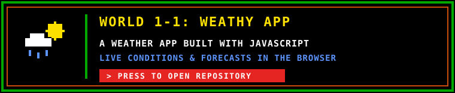
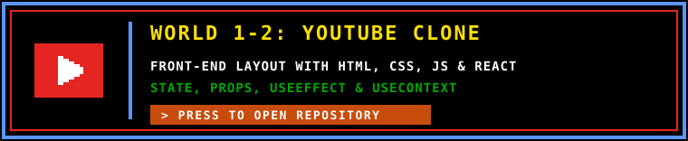
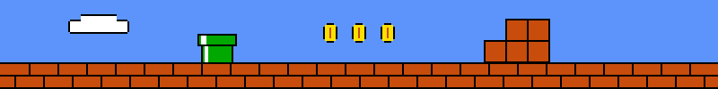

  

  

  

  

  

  

  
  

  

  

  

  

  
  
  
  
  
  
  
  

| Power-Up | Usage |
| :--- | :--- |
| **HTML** | Semantic structure, accessible page layouts, and clean document markup. |
| **CSS** | Responsive layouts, Flexbox, Grid, custom styling, and visual components. |
| **JavaScript** | Interactive DOM behavior, asynchronous API requests, and client-side logic. |
| **React** | Multi-component apps using state, props, `useEffect`, and `useContext` to solve prop drilling. |
| **Node.js** | Server-side JavaScript runtime environment for full-stack development. |
| **Git** | Local version control, branching, and commit history management. |
| **GitHub** | Remote repository hosting, code collaboration, and project tracking. |
| **VS Code** | Primary code editor for writing, debugging, and formatting web applications. |

  

  

  <strong>⭐ Weathy App</strong>: A weather app built with JavaScript. 🔗 <a href="https://github.com/MaZeNN113/Weathy-App">https://github.com/MaZeNN113/Weathy-App</a>

  

  <strong>⭐ YouTube Clone</strong>: Front-end video interface built with HTML, CSS, JavaScript, and React components using state, props, `useEffect`, and `useContext`. 🔗 <a href="https://github.com/MaZeNN113/YouTubeClone26">https://github.com/MaZeNN113/YouTubeClone26</a>

  

  

  

